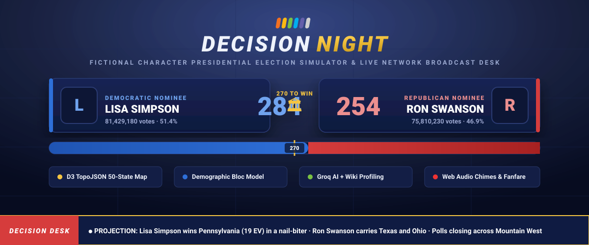

<div align="center">



# 🏛️ DECISION NIGHT
### *Fictional Character Presidential Election Simulator & Live Broadcast Engine*

[](https://opensource.org/licenses/MIT)
[](https://developer.mozilla.org/en-US/docs/Web/JavaScript)
[](https://d3js.org/)
[](https://developer.mozilla.org/en-US/docs/Web/API/Web_Audio_API)
[](https://groq.com/)
[](https://pages.github.com/)

<p align="center">
  <b>Simulate the race to 270 with any fictional character in cinematic, network-broadcast real time.</b><br>
  Built with authentic election-desk graphics, demographic swing models, D3 choropleth maps, audio stingers, and AI character profiling.
</p>

[🎮 **Launch Live Demo**](https://noorhorse01.github.io/election-simulator/) • [✨ **Features**](#-key-features) • [🧠 **Simulation Model**](#-simulation-engine--math) • [🚀 **GitHub Pages Deployment**](#-github-pages-deployment)

---

</div>

## 🌟 Overview

**Decision Night** transforms any hypothetical presidential matchup into a nail-biting, cable-news-style Election Night experience. Pit **Lisa Simpson against Ron Swanson**, **Tony Stark against Shrek**, or **Scrooge McDuck against Leslie Knope**.

Watch real-time poll closings starting at 6:00 PM Eastern, live county/state counting speeds, breaking-news projection banners with authentic three-note synthesizer chimes, shifting electoral bars toward the golden 270 threshold, and state-by-state demographic exit-poll analysis.

---

## ⚡ Key Features

### 📺 Network Broadcast Graphics & Sound
- **Election Desk Aesthetics**: Deep navy and metallic gold broadcast design inspired by major cable networks (NBC Decision Desk, CNN Magic Wall).
- **Breaking Projections**: Dynamic pop-in projection banners triggered whenever a state crosses mathematical call thresholds.
- **Web Audio API Synth**: Custom zero-dependency procedural synthesizer generating three-note network stingers (`chime()`) and victory fanfares (`fanfare()`) with no external audio files required.
- **Breaking News Ticker**: Authentic scrolling lower-third chyron reporting vote tallies, turnout anomalies, and "Kornacki-style" exit poll insights.
- **Speed & Sound Controls**: Real-time simulation speed toggle (1× or 4×) and instantaneous audio mute controls.

### 🗺️ Interactive 50-State D3 & TopoJSON Map
- **Live Choropleth Coloring**: Distinct color states for called races, uncalled tossups, and early-vote leads (Democratic Deep Blue / GOP Deep Red vs. Lean Light Blue / Lean Light Red).
- **Split-EV Districts**: High-fidelity support for Maine (`ME-1`, `ME-2`) and Nebraska (`NE-1`, `NE-2`, `NE-3`) congressional district allocations alongside statewide totals.
- **Interactive Tooltips**: Hover over any state to inspect projected popular vote counts, reporting percentages, poll closing hours, and key demographic voting bloc swings.

### 👥 50+ Hand-Crafted Characters & AI Auto-Profiling
- **Curated Roster**: 50+ pre-tuned characters with customized ideological placement (`ideo`), charisma (`cha`), pro-business appeal (`biz`), rural strength (`rur`), religious crossover (`rel`), youth turnout boost (`yth`), national fame (`pop`), and home-state advantage (`home`).
- **Groq Llama 3.3 Integration**: Optionally enter a free Groq API key to generate instant, context-aware political dossiers on *any* fictional character.
- **Wikipedia Heuristic Fallback**: Zero-config estimation engine that scans Wikipedia character bios to infer statistical attributes when running without an API key.
- **Custom Trait Fine-Tuning**: Full interactive sliders to manually tailor candidate attributes before the first poll closes.

---

## 🧠 Simulation Engine & Math

The underlying simulation engine calculates realistic election outcomes based on multi-variate statistical modeling:

```
Margin = StateBaselineLean + NationalMood + RegionalSwing + Σ(BlocWeight × BlocSwing) + HomeStateBonus ± RandomNoise
```

### 1. Demographic Voter Blocs
The electorate in every state is broken down across seven dynamic demographic segments:
* **Urbanites**: Driven by social ideology and progressive youth appeal.
* **Evangelicals**: Heavily swayed by religious appeal, conservatism, and cultural framing.
* **Youth (18–29)**: Sensitive to candidate charisma, progressive stances, and social media reach.
* **Business / Suburbs**: Responsive to pro-business policies, fiscal conservatism, and stability.
* **College Educated**: Rewards competence, technocratic appeal, and moderate ideological balance.
* **Union / Blue-Collar**: Sensitive to populist rhetoric, manufacturing protection, and economic fairness.
* **Seniors**: High-turnout bloc penalizing volatility, rewarding institutional familiarity.

### 2. Dynamic Turnout & Skew
- **Energized Base Multiplier**: High swings in specific demographic groups boost overall turnout weight for that bloc.
- **Early Vote Decay**: Simulates early and mail-in voting skews that gradually stabilize as reporting approaches 100%.
- **Graduated Call Thresholds**: High-margin states (e.g. DC, Wyoming) are called immediately upon poll close (1% in); razor-thin swing states (e.g. Pennsylvania, Wisconsin, Georgia) hold out until 93%+ reporting.

---

## 📂 Repository Structure

```
election-simulator/
├── .github/
│   └── workflows/
│       └── pages.yml          # Automated GitHub Pages CI/CD workflow
├── assets/
│   └── banner.svg             # High-resolution vector broadcast banner
├── index.html                 # Complete, self-contained single-page application
├── .gitignore                 # Clean repository hygiene rules
├── LICENSE                    # Permissive MIT License
└── README.md                  # Comprehensive documentation & setup guide
```

---

## 🚀 Quick Start

### Run Locally in 1 Second (No Build Tools Required!)
Because Decision Night is written in pure, modern vanilla HTML5/ES6, no bundlers, compilation steps, or Node.js installations are required.

#### Option A: Direct Open
Double-click `index.html` in your file browser or open it directly in Chrome, Firefox, Safari, or Edge.

#### Option B: Local HTTP Server (Python / Node)
```bash
# Using Python 3:
python3 -m http.server 8000

# Or using npx:
npx serve .
```
Navigate to `http://localhost:8000` in your browser.


---

## 🛠️ Tech Stack & Dependencies

* **Frontend**: Vanilla HTML5, Modern CSS3 (Grid, Flexbox, CSS Variables, Glassmorphism).
* **Mapping Engine**: [D3.js v7](https://d3js.org/) & [TopoJSON Client v3](https://github.com/topojson/topojson-client) rendering Albers USA projections.
* **Atlas Data**: [us-atlas](https://github.com/topojson/us-atlas) 10m topological vector boundaries.
* **Audio**: Native [Web Audio API](https://developer.mozilla.org/en-US/docs/Web/API/Web_Audio_API) (OscillatorNode & GainNode frequency synthesis).
* **AI Engine**: [Groq Cloud API](https://console.groq.com/) running `llama-3.3-70b-versatile`.
* **Knowledge Base**: [Wikipedia REST API](https://en.wikipedia.org/api/rest_v1/) for automated metadata and photo resolution.

---

## 🤝 Contributing

Contributions, character additions, and simulation improvements are warmly welcomed!
1. Fork the Project
2. Create your Feature Branch (`git checkout -b feature/NewCandidate`)
3. Commit your Changes (`git commit -m 'Add Ted Lasso character profile'`)
4. Push to the Branch (`git push origin feature/NewCandidate`)
5. Open a Pull Request

---

## 📄 License

Distributed under the **MIT License**. See [`LICENSE`](./LICENSE) for full details.

---

<div align="center">
  <sub>Engineered with precision for political junkies, simulation enthusiasts, and pop culture fans.</sub>
</div>
